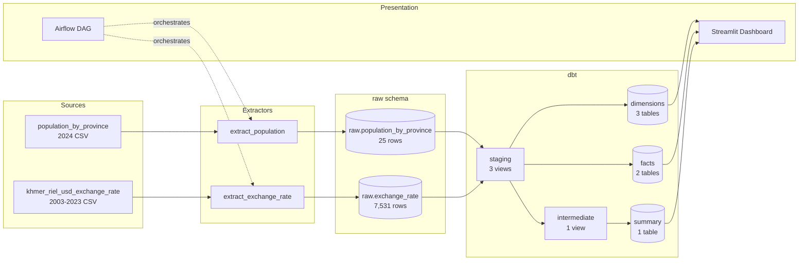
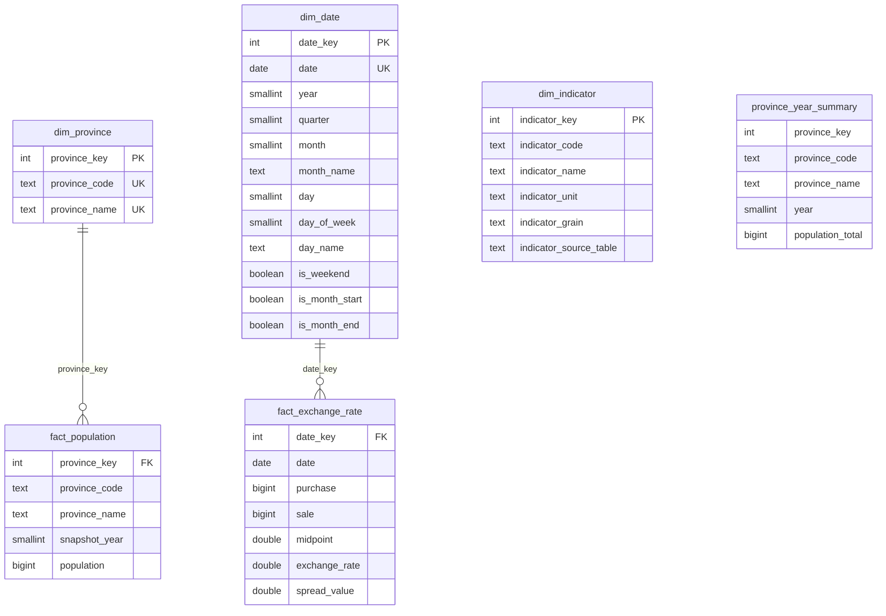
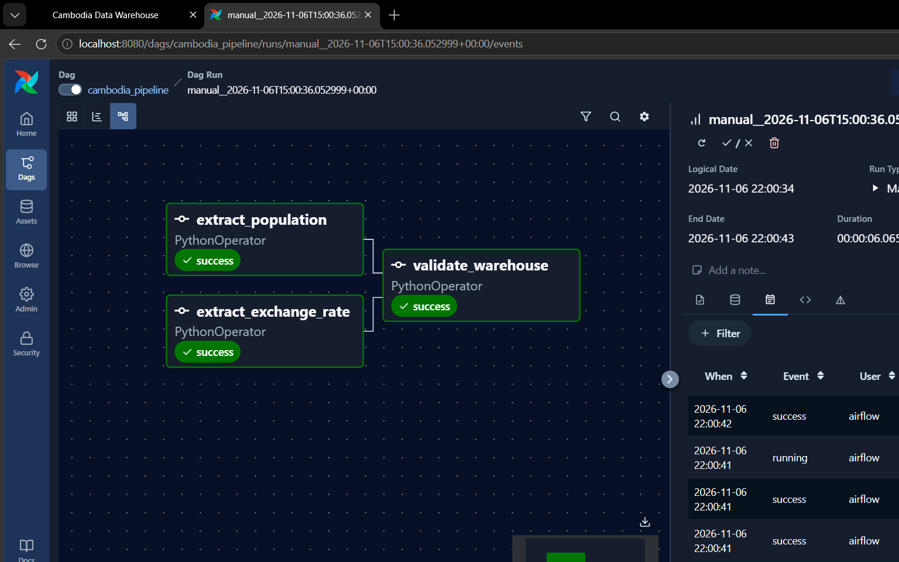
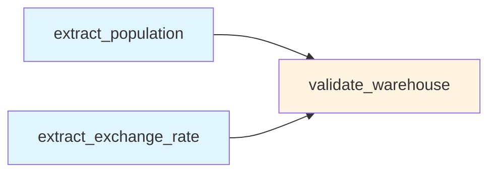

# Cambodia Data Warehouse

**An end-to-end data pipeline built to practice real Data Engineering: extraction, dimensional modelling, testing, orchestration, and presentation.**

[](https://www.python.org/)
[](https://www.postgresql.org/)
[](https://www.getdbt.com/)
[](https://airflow.apache.org/)
[](https://streamlit.io/)
[](https://www.docker.com/)


[](https://github.com/prakveasna2025-hash/cambodia-airflow-pipeline/actions/workflows/ci.yml)

---

## Table of Contents

- [About](#about)
- [Architecture](#architecture)
- [Data Model](#data-model)
- [Orchestration](#orchestration)
- [Tech Stack](#tech-stack)
- [Data Sources](#data-sources)
- [Data Quality](#data-quality)
- [Quick Start](#quick-start)
- [Project Structure](#project-structure)
- [Design Decisions](#design-decisions)
- [Documentation](#documentation)

---

## About

This is a **learning project**, not a production system. It exists to build muscle memory for the shape of real Data Engineering work.

Two Cambodian datasets - province population (2024 snapshot) and USD/KHR exchange rates (2003-2023) - flow through a full modern data stack: **Python extractors -> PostgreSQL -> dbt transformations -> Airflow orchestration -> Streamlit dashboard.**

Along the way, the project demonstrates:

| Category | What |
|---|---|
| Dimensional modelling | Kimball star schema with surrogate keys |
| Layered testing | 4 independent test layers, 79 total tests |
| Idempotent loads | TRUNCATE + INSERT preserves dependent views |
| Blue/green migrations | Verify new before retiring old |
| Data quality contracts | Known defects pinned at exact counts |
| Clean-room tested | Clone + follow README, end to end |

---

## Architecture



**Five layers, one flow.** Each layer has a distinct job. Each layer has tests.

---

## Data Model

Star schema built with dbt. Dimensions describe context, facts hold measures.



**Two facts, incompatible grains** - population is province-annual; exchange rates are date-national. Kept separate rather than forced into a sparse "unified" fact.

---

## Orchestration

The Airflow DAG runs two extractors in parallel, then validates the warehouse.





| Feature | Setting |
|---|---|
| Parallel fan-out | Two extractors, no sequencing between them |
| Fan-in validation | Runs only after both extracts succeed |
| Retries | 2 with exponential backoff (1min, 2min, 4min, capped 10min) |
| Schedule | `None` - manual trigger only |
| Catchup | `False` - no backfill on activation |

---

## Tech Stack

| Layer | Tool |
|---|---|
| Extraction | **Python 3.13** + pandas + SQLAlchemy |
| Warehouse | **PostgreSQL 16** (Docker) |
| Transformations | **dbt-core + dbt-postgres 1.12** |
| Orchestration | **Apache Airflow 3.3.2** (CeleryExecutor) |
| Dashboard | **Streamlit** |
| Environment | **uv** (dependency management) |
| Deployment | **Docker Compose** (two stacks) |
| Testing | **pytest** + dbt tests |

---

## Data Sources

| Dataset | Rows | Range | Quality |
|---|---|---|---|
| Population by Province (Cambodia, 2024) | 25 | 2024 snapshot | Clean - verified Day 2 |
| USD/KHR Exchange Rate (NBC) | 7,531 | 2003-04-01 to 2023-12-31 | Documented defects - see [source notes](docs/source-notes.md) |

---

## Data Quality

Four independent test layers. Each catches something the others can't.

| Layer | Where | Count |
|---|---|---|
| Unit tests | `tests/test_validators.py` | **12 pytest tests** |
| DataFrame validation | `scripts/validators.py` | pre-load, fail-fast |
| Warehouse health | `scripts/validate_warehouse.py` | 7 check categories |
| dbt tests | `cambodia_dw/models/**/schema.yml` + `cambodia_dw/tests/*.sql` | **67 tests** |

### Known source defects - pinned, not hidden

The NBC exchange-rate source has documented quality issues. Rather than silently "fix" them, they're **pinned at exact expected counts** and asserted:

| Defect | Count | Where enforced |
|---|---|---|
| Inverted bid/ask (`purchase > sale`) | **16 rows** | `EXPECTED_INVERTED_ROWS = 16` |
| Missing days (April 2008 absent + scattered) | **49 days** | `EXPECTED_MISSING_DAYS = 49` |
| Midpoint rounding inconsistencies | **2,109 rows** | `EXPECTED_EXCHANGE_ROWS` set |

**If the counts drift, the extractor aborts.** The pipeline accepts known defects at their baseline, but refuses drift.

**Defects are documented in [`docs/source-notes.md`](docs/source-notes.md).**

---

## Quick Start

### Prerequisites

- **Docker Desktop** running
- **Python 3.13** via `uv` - [install guide](https://docs.astral.sh/uv/getting-started/installation/)

```powershell
powershell -ExecutionPolicy ByPass -c "irm https://astral.sh/uv/install.ps1 | iex"
```

### 1. Configure environment (first time only)

Two `.env` files and one `~/.dbt/profiles.yml` are **not committed** (they hold secrets). Create them from templates:

```powershell
Copy-Item docker\.env.example docker\.env
Copy-Item docker\airflow\.env.example docker\airflow\.env
```

**Generate a Fernet key** and paste it into `docker\airflow\.env` (replace `FERNET_KEY=CHANGE_ME`):

```powershell
docker run --rm python:3.13-slim sh -c "pip install cryptography -q && python -c 'from cryptography.fernet import Fernet; print(Fernet.generate_key().decode())'"
```

**Create the dbt profile** at `~/.dbt/profiles.yml`:

```powershell
New-Item -ItemType Directory -Force "$HOME\.dbt" | Out-Null
notepad "$HOME\.dbt\profiles.yml"
```

Paste:

```yaml
cambodia_dw:
  target: dev
  outputs:
    dev:
      type: postgres
      host: 127.0.0.1
      port: 5434
      user: airflow
      password: changeme
      dbname: airflow
      schema: dbt_dev
      threads: 4
```

> **Why `127.0.0.1:5434` here but `cambodia_dw_postgres:5432` in `docker/airflow/.env`?**
> dbt runs on your **host** and uses the host-mapped port. Airflow runs **inside Docker** and uses the container DNS name and internal port.

### 2. Start the stack

```powershell
docker compose -f docker/docker-compose.yml up -d
docker compose -f docker/airflow/docker-compose.yaml up -d
docker ps --format "table {{.Names}}\t{{.Status}}"
```

### 3. Build the warehouse

```powershell
uv sync
uv run dbt seed --project-dir cambodia_dw
uv run dbt run  --project-dir cambodia_dw
uv run dbt test --project-dir cambodia_dw
```

### 4. Trigger the pipeline

**From the UI:** `http://localhost:8080` -> login `airflow`/`airflow` -> `cambodia_pipeline` -> play button

**Or from the CLI:**

```powershell
docker exec airflow-airflow-scheduler-1 airflow dags trigger cambodia_pipeline
```

### 5. Open the dashboard

```powershell
uv run streamlit run dashboard/app.py
```

Open **http://localhost:8501**

---

## Project Structure

```
cambodia-airflow-pipeline/
|
+-- dags/                       Airflow DAG definitions
|   +-- cambodia_pipeline_dag.py
|
+-- scripts/                    Python extraction + validation
|   +-- extract_population.py
|   +-- extract_exchange_rate.py
|   +-- validators.py              DataFrame validators
|   +-- validate_warehouse.py      Post-load health checks
|
+-- sql/                        SQL scripts + analysis
|   +-- create_dim_date.sql        Hand-built (legacy, Phase 2 pending)
|   +-- create_dim_province.sql    Hand-built (legacy, Phase 2 pending)
|   +-- analysis/                  8 exploratory queries
|
+-- cambodia_dw/                dbt project
|   +-- seeds/                     2 reference CSVs
|   +-- models/
|   |   +-- staging/               3 views (stg_*)
|   |   +-- intermediate/          1 view (int_*)
|   |   +-- marts/                 6 tables (dim_*, fact_*, summary)
|   +-- tests/                     Custom SQL tests
|
+-- tests/                       pytest unit tests
|
+-- dashboard/                   Streamlit app
|   +-- app.py
|
+-- docs/                        Documentation
|   +-- data-dictionary.md
|   +-- data-quality.md
|   +-- limitations.md
|   +-- source-notes.md
|   +-- devlog.md
|   +-- screenshots/
|
+-- docker/                      Docker Compose stacks
|   +-- docker-compose.yml         Warehouse Postgres
|   +-- airflow/                   Airflow stack
|
+-- pyproject.toml               uv project config
```

---

## Design Decisions

A few decisions that matter for correctness:

| Decision | Why |
|---|---|
| Load raw as-is | Raw layer is a faithful copy of source. Cleaning is a downstream concern. |
| TRUNCATE + INSERT | `DROP + CREATE` breaks dependent dbt views. `TRUNCATE` preserves structure. |
| Seeds not `SELECT DISTINCT` | `dim_province` is a **spec**, not a consequence of facts. |
| Explicit surrogate keys | `ROW_NUMBER` renumbers on insert and breaks FKs silently. Explicit keys are stable. |
| Views vs tables | Staging = view (cheap). Marts = table (queried repeatedly). |
| Defects pinned at exact counts | Silent drift is the enemy. Baselines are asserted. |
| Blue/green migrations | New dims built alongside old, verified by set difference, then old retired. |

---

## Documentation

| Document | Purpose |
|---|---|
| [Data Dictionary](docs/data-dictionary.md) | Column-level docs for every table |
| [Data Quality](docs/data-quality.md) | Test coverage, what's tested, what isn't |
| [Limitations](docs/limitations.md) | Honest gaps - what this project does NOT do |
| [Source Notes](docs/source-notes.md) | Provenance + documented source defects |
| [Devlog](docs/devlog.md) | Day-by-day development history |

---

## Roadmap

- [ ] **Phase 2 of Day 19** - Retire legacy `dim.*` tables, refactor `stg_province` to read from seed
- [ ] **DAG runs dbt** - Add `dbt run` and `dbt test` as Airflow tasks
- [ ] **dbt docs** - `dbt docs generate` + host on GitHub Pages
- [ ] **Source freshness** - `freshness:` blocks in `sources.yml`
- [x] **CI/CD** - GitHub Actions: pytest + dbt test on every push
- [ ] **More years** - Population time series once multi-year data arrives

---

## Interview Highlights

- **Fan-out / fan-in DAG** with exponential backoff retries
- **Three-layer dbt architecture** (`_staging`, `_intermediate`, `_marts` schemas)
- **Two-endpoint connection strings** - same DB, different host from host vs container
- **Shared external Docker network** bridging two Compose stacks
- **Blue/green dimension migration** with set-difference verification
- **Defect-pinned validation** - accept known defects, catch drift
- **Idempotent loads** - TRUNCATE + INSERT preserves dependent views
- **Clean-room tested** - clone + follow README, end to end

---

## License

MIT - see [LICENSE](LICENSE).